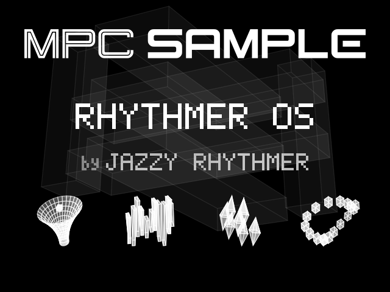
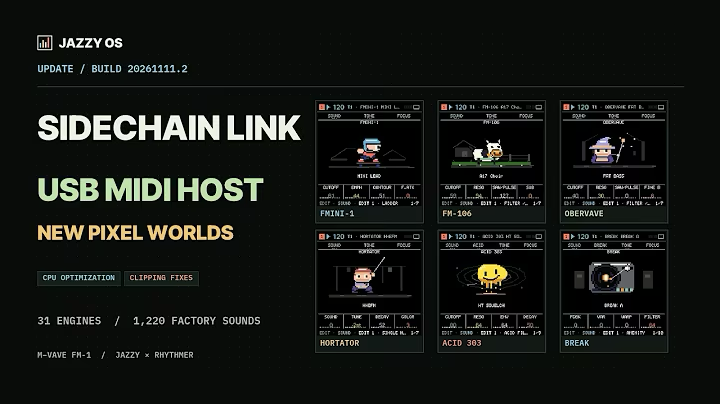
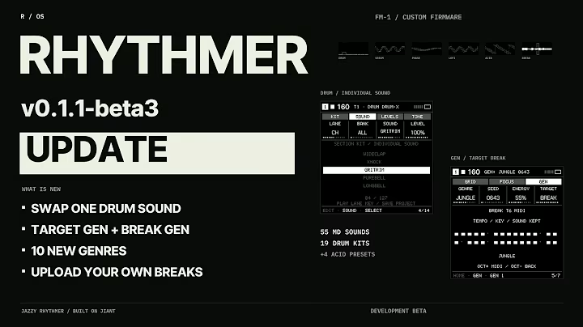
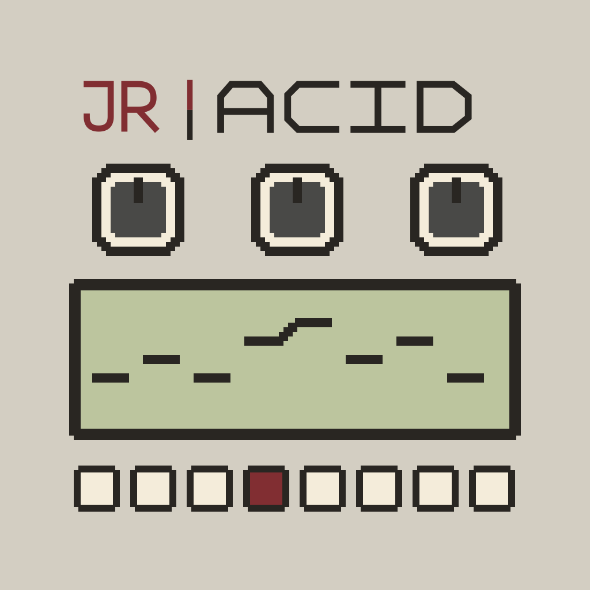
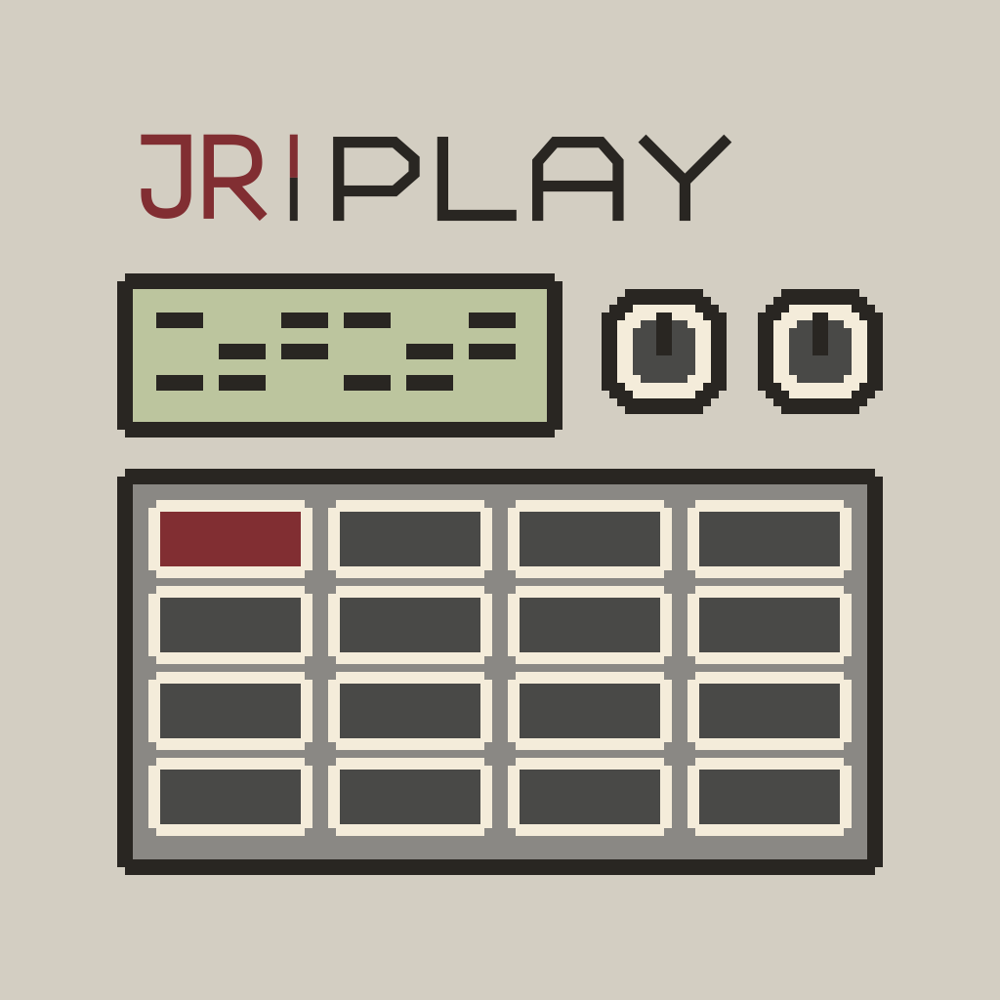

# Jazzy Rhythmer

**In search of feel-good rhythms.**

I make music. And the tools to keep it moving. I'm an independent music producer exploring rhythm, texture and the possibilities inside small machines — sharing music and sessions, and building **JR Audio Software**.

[Website](https://jazzyrhythmer.github.io/) · [Software](https://jazzyrhythmer.github.io/software.html) · [Studio Notes & updates](https://jazzyrhythmer.github.io/#notes)

## For MPC Sample

### RHYTHMER OS

**Your MPC Sample. A wider world of sound and groove.**

An unofficial, free and open-source groovebox environment for Jungle, Techno, House & IDM: 20 plug-in entries, 36 Rhythmer Kits, hands-on sound design, GEN, Acid and Break workflows.

[Download & installation](https://jazzyrhythmer.github.io/mpc-sample/installer/) · [Manual](https://jazzyrhythmer.github.io/mpc-sample/manual/) · [First pattern](https://jazzyrhythmer.github.io/mpc-sample/manual/quickstart.html) · [OS source](https://github.com/jazzyrhythmer/mpc-sample-rhythmer-os) · [Engine port sources & credits](https://github.com/jazzyrhythmer/mpc-sample-engine-ports)

**Early beta:** offline build, audio-host and UI checks are documented; physical MPC Sample validation remains pending. Built on [Melodee](https://github.com/keremimo/melodee) by Kerem Kiliç (Ellic Studio), with work by many open-source contributors. Original authorship and component licenses are preserved in the source repositories.

## For FM-1

### JAZZY

**Explore the unheard.** Browse 31 synth, drum and Break engines and over 1,200 factory sounds. One sound per track.

[Watch the update](https://www.youtube.com/watch?v=sTyKCdER6a0) · [Explore](https://jazzyrhythmer.github.io/jazzy/) · [Play](https://jazzyrhythmer.github.io/jazzy/emulator/) · [Install](https://jazzyrhythmer.github.io/jazzy/installer/) · [Source](https://github.com/jazzyrhythmer/jazzy)

### RHYTHMER

**Sound into motion.** Build grooves with assignable tracks, individual drum swaps, generation and break chops. Built on JIANT.

[Watch the update](https://www.youtube.com/watch?v=98T8jz5DHV4) · [Explore & guide](https://jazzyrhythmer.github.io/rhythmer/) · [Play](https://jazzyrhythmer.github.io/rhythmer/#play) · [Install](https://jazzyrhythmer.github.io/rhythmer/installer/) · [Source](https://github.com/jazzyrhythmer/rhythmer)

## JR Audio Software

**Expected in 2027.** All JR apps below are planned for 2027. Join [Studio Notes](https://jazzyrhythmer.github.io/index.html#notes) for previews and release news.

| | Project | The idea |
| --- | --- | --- |
|  | **[JR ACID](https://jazzyrhythmer.github.io/software.html#jr-acid)** Generative acid instrument EXPECTED 2027 | Generate a squelchy bassline, lock your favorite steps, and mutate the rest. |
|  | **[JR FX](https://jazzyrhythmer.github.io/software.html#jr-fx)** Performance effects EXPECTED 2027 | Turn loops into live performances with hands-on pads and expressive effects. |
|  | **[JR FLOW](https://jazzyrhythmer.github.io/jr-flow.html)** Audio & MIDI Host EXPECTED 2027 | **All your sounds. A little more connected.** Connect instruments, shape effects and catch the moment it all clicks. A mixer for ideas that want to play together. |
|  | **[JR CHORD](https://jazzyrhythmer.github.io/jr-chord.html)** MIDI Chord Performance & Sequencing EXPECTED 2027 | **Find a chord. Change the mood.** Play rich MIDI chords, shape a progression and turn it into a sequence. Give your instruments a new direction. |
|  | **[JR TREK](https://jazzyrhythmer.github.io/software.html#jr-trek)** Generative MIDI sequencer EXPECTED 2027 | Generate evolving MIDI patterns for the instruments you already play. |
|  | **[JR SMPL](https://jazzyrhythmer.github.io/software.html#jr-smpl)** Pad sampler EXPECTED 2027 | Vintage sampling workflow. Fresh ideas. Chop it, tap it, make a classic. |
|  | **[JR DRAW](https://jazzyrhythmer.github.io/software.html#jr-draw)** Drawing instrument EXPECTED 2027 | Sketch a line and hear it become a playable musical phrase. |
|  | **[JR RYTM](https://jazzyrhythmer.github.io/software.html#jr-rytm)** Performance groovebox EXPECTED 2027 | Build a beat and bend it live with scenes and performance controls. |
|  | **[JR PLAY](https://jazzyrhythmer.github.io/software.html#jr-play)** Pattern-to-song workstation EXPECTED 2027 | Start with a loop and turn it into a song. |

[Explore the software](https://jazzyrhythmer.github.io/software.html) · [Get launch news](https://jazzyrhythmer.github.io/#notes)

## Support the next idea

If you enjoy the music or find these tools useful, your support helps me keep creating and sharing the next one. The open-source firmware remains free.

[Ko-fi](https://ko-fi.com/jazzyrhythmer) · [Patreon](https://www.patreon.com/JazzyRhythmer/) · [Studio Notes & email updates](https://jazzyrhythmer.github.io/#notes)

## Music & process

[YouTube](https://www.youtube.com/@jazzyrhythmer) · [Instagram](https://www.instagram.com/jazzyrhythmer/) · [SoundCloud](https://soundcloud.com/jazzyrhythmer) · [Bandcamp](https://jazzyrhythmer.bandcamp.com/)

Public inquiries: [jazzyrhythmer@gmail.com](mailto:jazzyrhythmer@gmail.com)
